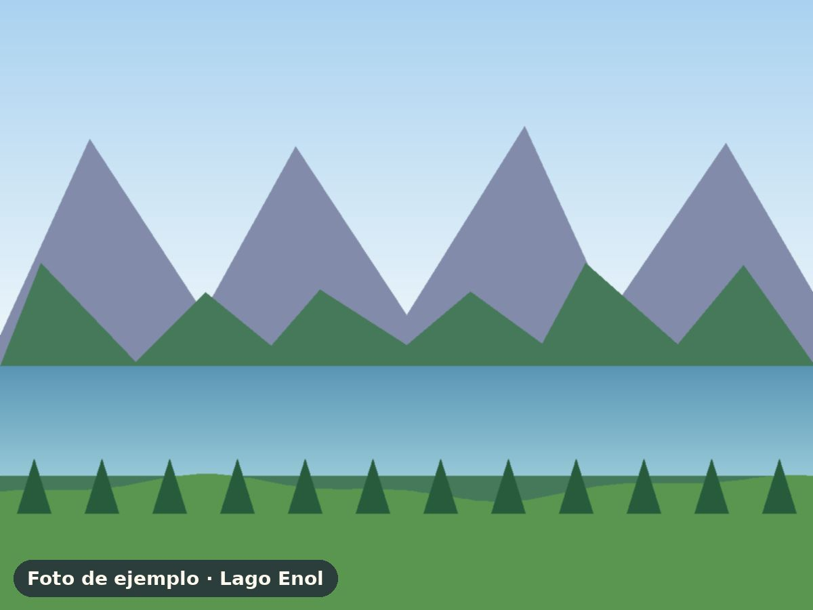
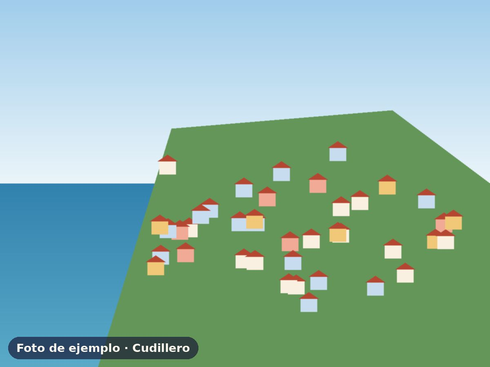

## En pocas palabras

Una semana en agosto huyendo del calor. Asturias es perfecta con niños: hay montaña, playa, museos con dinosaurios y distancias cortas.
Alquilamos una casa rural en el centro de la región y desde allí hicimos excursiones de ida y vuelta.
No hizo falta hacer maletas cada dos días, y eso con niños se agradece mucho.

## Cuándo ir

- **Julio y agosto**: temperaturas suaves (20-25 °C), ideal para escapar del calor. Es temporada alta: reservad pronto.
- **Junio y septiembre**: menos gente y mejores precios, pero el agua del mar está fría.
- **Lluvia**: puede llover cualquier día del año. Llevad siempre un chubasquero.

> En Asturias el tiempo cambia en minutos. Mirad la previsión por la mañana y tened un plan B bajo techo (museo, acuario).
{: .dato}

## Cómo llegar y moverse

- **Coche**: imprescindible. Las mejores playas y pueblos están mal comunicados en transporte público.
- **Distancias**: casi todo está a menos de 1 hora y media desde el centro de Asturias.
- **Lagos de Covadonga**: en verano no se puede subir en coche propio en las horas centrales. Hay que ir en el autobús oficial desde Cangas de Onís. Horarios y precio: *(por confirmar)*{: .por-confirmar}

> Reservad el autobús de los Lagos con días de antelación y coged el primero de la mañana: hay menos gente y más luz.
{: .truco}

## Itinerario día a día



### Día 1: Llegada y Oviedo

🌅 **Mañana:** viaje en coche y llegada a la casa rural.

☀️ **Tarde:** paseo por el casco antiguo de **Oviedo**. A los niños les encantaron las estatuas por la calle.

🌙 **Noche:** cena en una sidrería: cachopo para compartir.

### Día 2: Covadonga y los Lagos

🌅 **Mañana:** **Basílica y Santa Cueva de Covadonga**. Autobús a los **Lagos** y ruta corta y llana alrededor del **lago Enol** (unos 5 km, apta para niños).

☀️ **Tarde:** pícnic junto al lago y bajada a Cangas de Onís, con su puente romano.

🌙 **Noche:** cena pronto, y a dormir: el día es intenso.

### Día 3: Llanes y los bufones

🌅 **Mañana:** **Bufones de Pría**: el mar sale disparado por agujeros entre las rocas. Id con marea alta y mar movido.

☀️ **Tarde:** playa cerca de **Llanes**.

🌙 **Noche:** paseo por el puerto de Llanes y helado.

> En los bufones hay acantilados sin barandilla. Llevad a los niños de la mano y no os acerquéis al borde.
{: .ojo}

### Día 4: Museo del Jurásico y playa

🌅 **Mañana:** **Museo del Jurásico de Asturias (MUJA)**: esqueletos gigantes y huellas de dinosaurio reales en la costa. Lo mejor del viaje para los niños.

☀️ **Tarde:** playa de **La Griega**, justo al lado, donde hay huellas de dinosaurio en las rocas.

🌙 **Noche:** cena en la casa.

### Día 5: Gijón

🌅 **Mañana:** **Acuario de Gijón**: perfecto si el día amanece lluvioso.

☀️ **Tarde:** playa de San Lorenzo y paseo por Cimadevilla, el barrio de pescadores.

🌙 **Noche:** cena en el puerto deportivo.

### Día 6: Cudillero y costa occidental

🌅 **Mañana:** **Cudillero**, pueblo de casas de colores colgadas sobre el puerto. Subid a los miradores.

☀️ **Tarde:** baño en una cala cercana.

🌙 **Noche:** pescado fresco en el puerto.

### Día 7: Hayedo y vuelta

🌅 **Mañana:** paseo corto por un hayedo cerca de la casa.

☀️ **Tarde:** vuelta a casa.

## Dónde comer

| Sitio | Qué pedir | Precio por persona |
|---|---|---|
| **Sidrería El Ejemplo** (Oviedo) | Cachopo para compartir y sidra | 20 € |
| **Casa Inventada** (Cangas de Onís) | Fabada asturiana y arroz con leche | 18 € |
| **Chiringuito La Ola Ficticia** (Llanes) | Bocadillos y raciones para los niños | 12 € |
| **Restaurante El Puerto Imaginario** (Cudillero) | Pescado del día a la plancha | 25 € |

> Las raciones en Asturias son enormes. Pedid medias raciones o compartid: con niños, un cachopo da para tres.
{: .truco}

## Dónde dormir

- **Centro de Asturias** (Cangas de Onís, Arriondas, Villaviciosa): todo queda a menos de 1 hora. Ideal para hacer excursiones de ida y vuelta.
- **Casa rural**: más espacio y cocina propia, perfecta para familias.
- **Costa** (Llanes, Ribadesella): más ambiente, pero más caro en agosto.

Nosotros alquilamos la **Casa Rural Ejemplo** (inventada) en Arriondas, con jardín y 3 habitaciones, por unos 90 € la noche.

## Presupuesto orientativo



| Concepto | Toda la familia | Comentario |
|---|---|---|
| 🚗 Transporte | 380 € | Gasolina, peajes y autobús de los Lagos |
| 🏡 Alojamiento | 630 € | 7 noches en casa rural |
| 🍽 Comida | 560 € | Mitad cocinando en casa, mitad fuera |
| 🎟 Actividades | 130 € | MUJA y Acuario de Gijón |
| **Total** | **1.700 €** | Unos 425 € por persona |

## Consejos prácticos

- **Reservas**: casa rural con meses de antelación; autobús de los Lagos, días antes.
- **Horarios**: muchos restaurantes de pueblo cierran la cocina a las 16:00 y a las 23:00.
- **Con niños**: alternad un día de excursión larga con uno de playa o museo.
- **Mareas**: miradlas antes de ir a la playa. Con marea alta algunas calas desaparecen.
- **Cobertura**: en la montaña no hay. Descargad los mapas antes de salir.

### Qué llevar

- [x] Chubasquero para todos
- [x] Escarpines (muchas playas tienen piedras)
- [x] Calzado de montaña ligero
- [x] Sudadera, incluso en agosto
- [ ] Bañador de repuesto (siempre falta uno)

## Galería



## Fuentes

- [Turismo de Asturias](https://www.turismoasturias.es/)
- [Museo del Jurásico de Asturias (MUJA)](https://www.museojurasicoasturias.com/)
- [Acuario de Gijón](https://www.acuariodegijon.es/)
