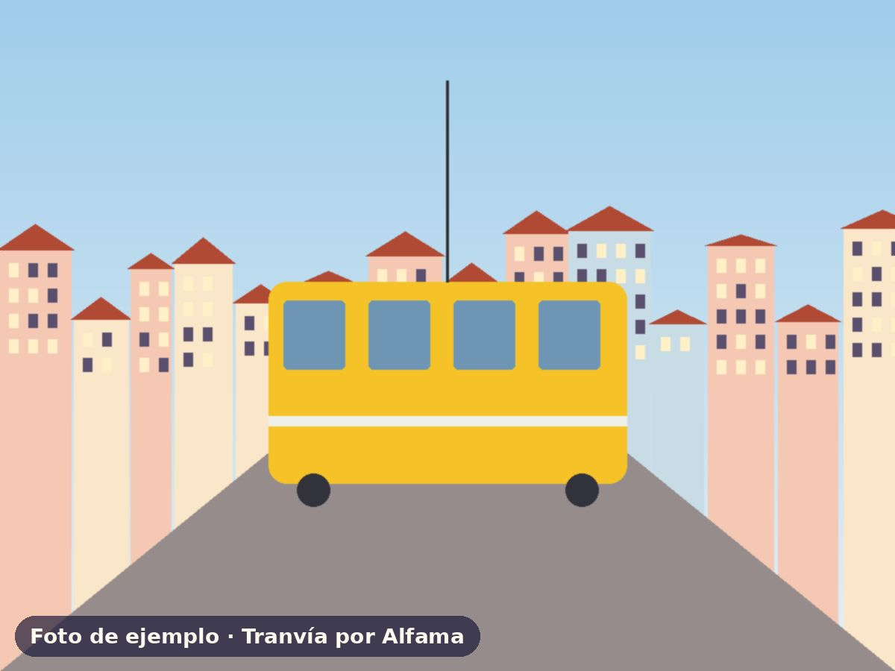
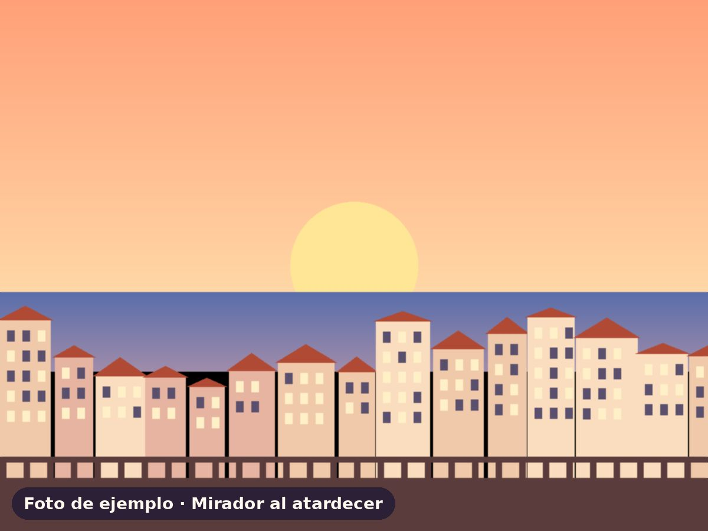

## En pocas palabras

Lisboa se disfruta andando. Fuimos cinco días en mayo, con buen tiempo y sin agobios de gente.
Combinamos barrios con encanto, miradores al atardecer y mucha comida rica. Un día lo dedicamos a Sintra y Cascais.

> Si solo tenéis tiempo para una cosa, que sea ver atardecer desde un mirador con algo de picar.
{: .cita}

## Cuándo ir

- **Primavera (abril a junio)** y **otoño (septiembre y octubre)**: la mejor época. Hace calor sin agobio.
- **Verano**: mucho calor y mucha gente. Reservad todo con tiempo.
- **Junio**: fiestas de los Santos Populares, con sardinas a la brasa en la calle.
- **Invierno**: suave pero lluvioso. Hay menos gente y los precios son más bajos.

## Cómo llegar y moverse

- **Avión**: el aeropuerto está muy cerca del centro. En metro (línea roja) llegáis en unos 25 minutos.
- **Tarjeta de transporte**: comprad la tarjeta recargable *Viva Viagem* en cualquier estación de metro. Sirve para metro, autobús, tranvía y elevadores.
- **A pie**: es la mejor forma de moverse, pero hay muchas cuestas. Llevad calzado cómodo.

> Montad en el tranvía 28 a primera hora (antes de las 9:00) o subid en la parada de Martim Moniz, donde empieza el recorrido. A mediodía las colas son eternas.
{: .truco}

> En los tranvías y en zonas muy turísticas hay carteristas. Llevad la mochila delante.
{: .ojo}

## Itinerario día a día



### Día 1: Alfama y el castillo

🌅 **Mañana:** llegada y paseo por Alfama sin rumbo, entre callejones y ropa tendida.

☀️ **Tarde:** subida al **Castillo de San Jorge** (entrada *(por confirmar)*{: .por-confirmar}) y parada en el **mirador de Santa Luzia**.

🌙 **Noche:** cena con fado en una tasca pequeña del barrio.

### Día 2: Baixa, Chiado y miradores

🌅 **Mañana:** Praça do Comércio, la Rua Augusta y el elevador de Santa Justa (por fuera; las vistas buenas son gratis desde arriba del Chiado).

☀️ **Tarde:** librerías y cafés del Chiado. Bajada al Cais do Sodré.

🌙 **Noche:** atardecer en el **mirador de la Senhora do Monte**, el más alto y el que más nos gustó.

### Día 3: Belém y LX Factory

🌅 **Mañana:** **Monasterio de los Jerónimos** y **Torre de Belém**. Llegad pronto.

☀️ **Tarde:** pasteles de nata (obligatorio) y paseo junto al río hasta el **LX Factory**, una antigua fábrica llena de tiendas y restaurantes.

🌙 **Noche:** cena informal en el LX Factory.

### Día 4: Excursión a Sintra y Cascais

🌅 **Mañana:** tren a Sintra (unos 40 minutos). **Palacio da Pena** y sus jardines.

☀️ **Tarde:** autobús a Cascais por la costa. Paseo por el puerto y la playa.

🌙 **Noche:** vuelta a Lisboa en tren por la costa.

> El Palacio da Pena se llena muchísimo. Comprad la entrada online con hora y subid en el primer turno.
{: .truco}

### Día 5: Mercado y despedida

🌅 **Mañana:** **Mercado da Ribeira (Time Out Market)** para probar de todo un poco.

☀️ **Tarde:** últimas compras (latas de conserva y azulejos) y al aeropuerto.

## Dónde comer

| Sitio | Qué pedir | Precio por persona |
|---|---|---|
| **Tasca da Avó Inventada** (Alfama) | Bacalao à Brás y vino verde | 18 € |
| **Pastelaria Exemplo** (Belém) | Pasteles de nata con canela | 3 € |
| **Cervejaria do Rio Imaginário** (Cais do Sodré) | Gambas al ajillo y *prego* (bocadillo de filete) | 25 € |
| **Mercado da Ribeira** | Un poco de todo, en distintos puestos | 15-20 € |

> En muchos restaurantes ponen pan, aceitunas y queso en la mesa sin pedirlo. No es gratis: si no lo queréis, decidlo y lo retiran.
{: .dato}

## Dónde dormir

- **Baixa y Chiado**: céntrico y llano. Ideal para una primera visita.
- **Alfama**: con mucho encanto, pero con cuestas y algo de ruido por la noche.
- **Príncipe Real**: tranquilo, bonito y con buenos restaurantes.

Nosotros dormimos en el **Hotel Ejemplo do Chiado** (inventado): habitación doble por unos 130 € la noche, con desayuno.

## Presupuesto orientativo



| Concepto | Por persona | Comentario |
|---|---|---|
| 🚆 Transporte | 190 € | Vuelos ida y vuelta, más metro, tranvía y tren a Sintra |
| 🛏 Alojamiento | 320 € | 4 noches en habitación doble compartida |
| 🍽 Comida | 210 € | Unos 40-45 € al día |
| 🎟 Actividades | 75 € | Castillo, Jerónimos y Palacio da Pena |
| **Total** | **795 €** | |

## Consejos prácticos

- **Reservas**: Palacio da Pena y Jerónimos, con antelación y online.
- **Horarios**: se come de 12:30 a 15:00 y se cena a partir de las 19:30, antes que en España.
- **Propinas**: no son obligatorias. Se suele dejar un 5-10 % si os han tratado bien.
- **Enchufes**: los mismos que en España (tipo F). No hace falta adaptador.
- **Idioma**: portugués. Muchos entienden español si habláis despacio, y el inglés funciona en todas partes.
- **Dinero**: euro. Se puede pagar con tarjeta casi en todas partes.

### Qué llevar

- [x] Calzado cómodo, con buena suela
- [x] Chaqueta fina para la noche (sopla aire del río)
- [x] Gafas de sol y crema
- [ ] Paraguas (en mayo no nos hizo falta)

## Galería



## Fuentes

- [Turismo de Lisboa (Visit Lisboa)](https://www.visitlisboa.com/)
- [Carris: tranvías y autobuses de Lisboa](https://www.carris.pt/)
- [Metro de Lisboa](https://www.metrolisboa.pt/)
- [Parques de Sintra (Palacio da Pena)](https://www.parquesdesintra.pt/)
