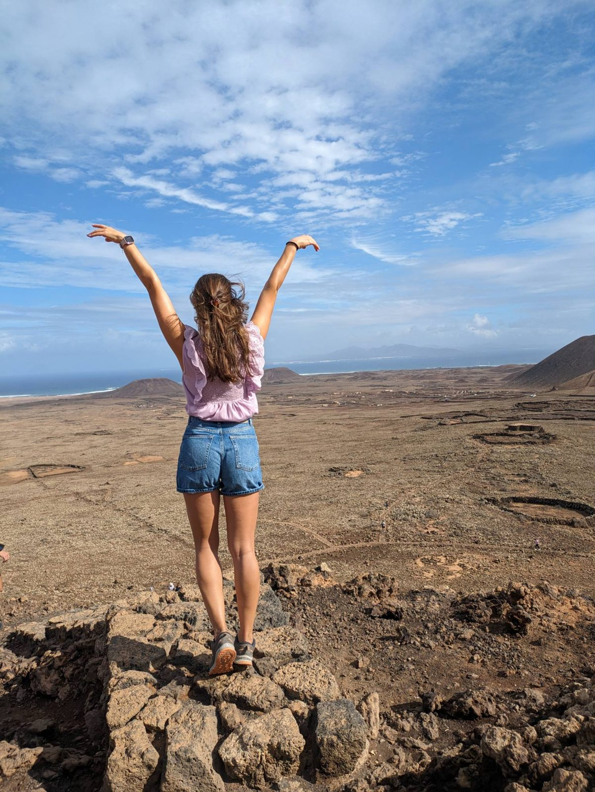
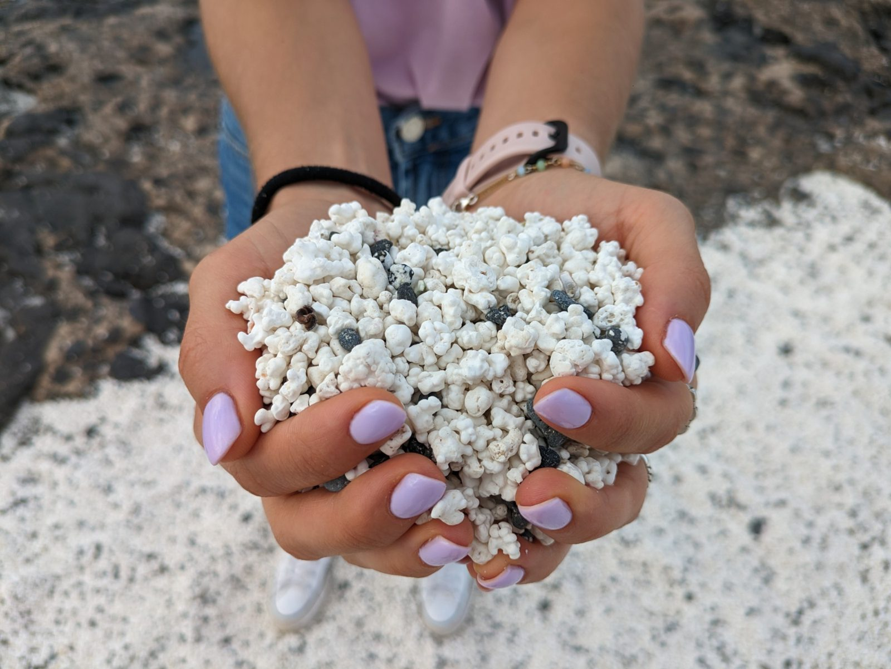
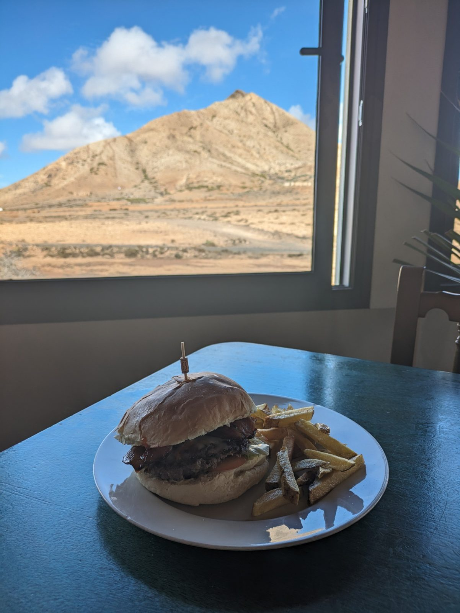
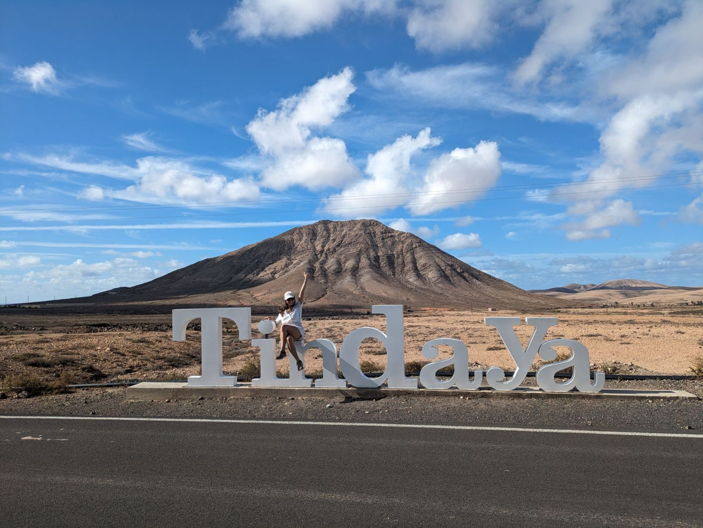
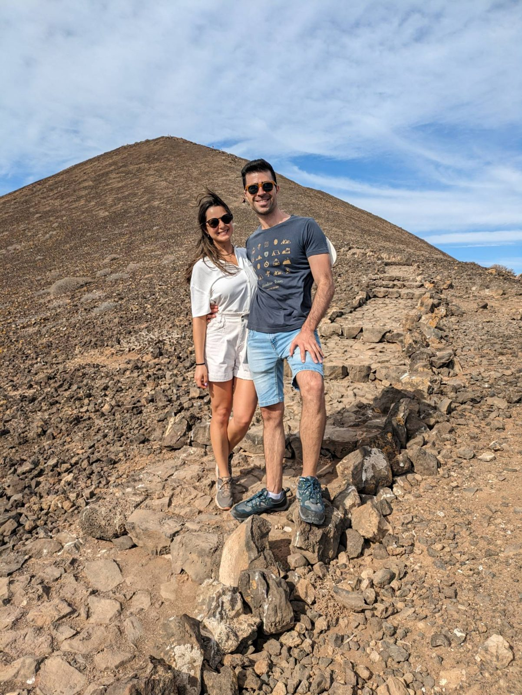
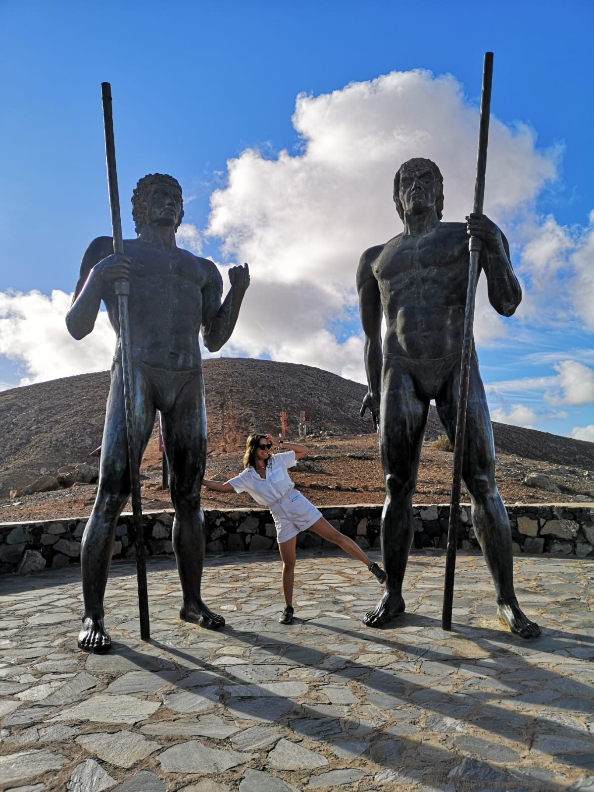
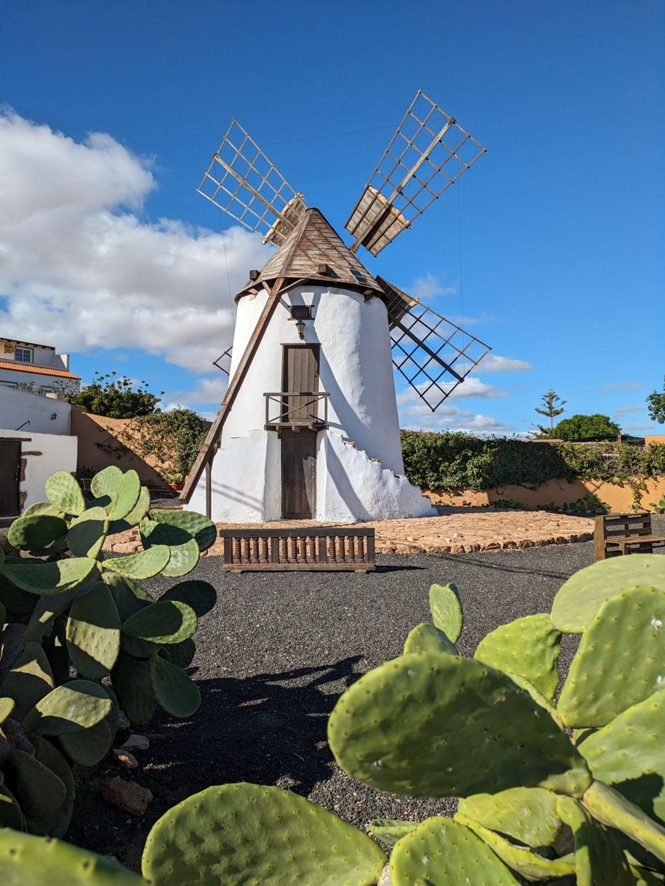
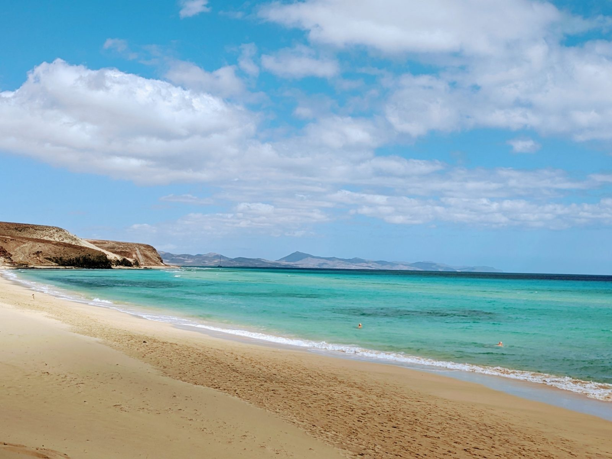
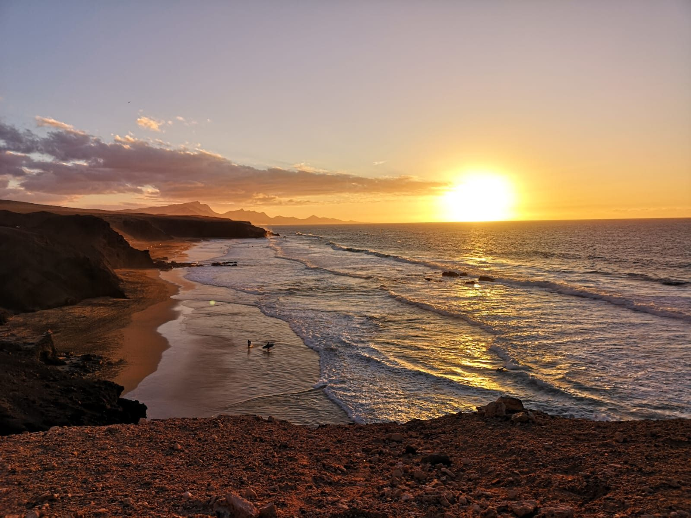
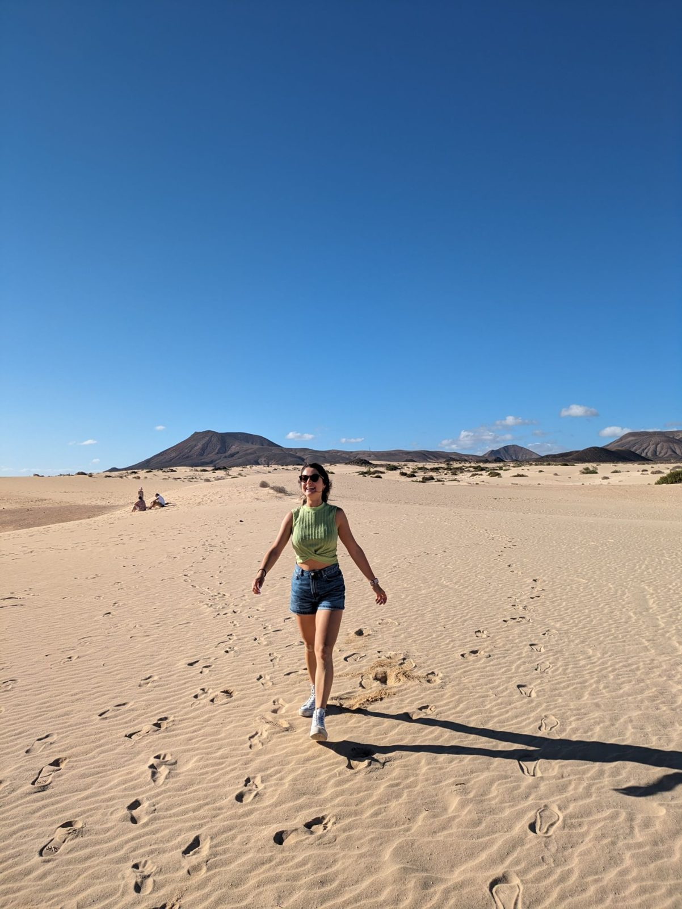

> **Antes de ir, revisad que todo sigue abierto.** Hicimos este viaje en octubre de 2023. Desde entonces pueden haber cambiado horarios, precios, accesos o normas. Algunos senderos, pistas, playas o restaurantes pueden estar cerrados por obras, desprendimientos o temporales. Consultad las webs oficiales del Cabildo de Fuerteventura y de cada ayuntamiento, y llamad a los restaurantes antes de ir.
{: .ojo}

## En pocas palabras

Fuerteventura es la isla de las playas: extensas, de arena blanca y con aguas turquesas, perfectas para bañarse.
Fuimos cinco noches en octubre, alojados en Caleta de Fuste, y recorrimos la isla en coche: volcanes y pueblos surferos en el norte, molinos y pueblos con historia en el centro, y un día entero de playa en el sur.
Nos escapamos también a la Isla de Lobos, y terminamos cada día viendo el atardecer en un sitio distinto.

## Cuándo ir

- **Todo el año**: Fuerteventura tiene buen tiempo en cualquier época.
- **Octubre**, cuando fuimos nosotros, es un mes estupendo: agua agradable para bañarse y menos gente que en verano.
- **Viento**: es la isla del viento. Llevad siempre algo de abrigo para los atardeceres y los miradores.

## Cómo llegar y moverse

- **Avión**: volamos desde Sevilla con Vueling hasta el aeropuerto de Fuerteventura (salimos a las 19:05 y llegamos a las 20:10, hora canaria). En Sevilla dejamos el coche en el parking de Aena, que reservamos antes.
- **Coche de alquiler**: imprescindible para recorrer la isla. Alquilamos con **Cicar**, como siempre que vamos a Canarias: se recoge y se deja en el mismo aeropuerto.
- **Dónde dormir para moverse**: elegimos Caleta de Fuste, a solo 11 minutos del aeropuerto y en el centro de la costa este. Desde ahí se llega bien al norte y al sur.
- **Distancias**: la isla es alargada y el sur queda lejos. Organizad cada día por zonas: norte, centro, sur y Corralejo.

> Para rutas de senderismo por la isla, nos fue muy útil la web [Dame Aventura](https://dameaventura.com/senderismo-fuerteventura/).
{: .dato}

## Itinerario día a día



### Día 1 (sábado): Llegada y Caleta de Fuste

🌙 **Noche:** al llegar, paseo por **Caleta de Fuste**: la zona del puerto y el castillo.

<!-- FOTO: Puerto y castillo de Caleta de Fuste de noche -->

### Día 2 (domingo): Volcanes, El Cotillo y el norte

🌅 **Mañana:** desayuno temprano y rumbo al **Volcán Calderón Hondo**. Id pronto. Desde el aparcamiento se tarda unos 45 minutos en subir y unos 30 en volver.
- Hay dos caminos: el de la derecha es más corto; el de la izquierda, más largo y complicado. Podéis subir por uno y bajar por el otro.
- Arriba, las vistas son preciosas: sentaos en una piedra a contemplar el cráter y el paisaje.
- Hay muchas ardillitas. **¡No les deis de comer!**

> No hay nada de sombra y sopla bastante viento: llevad agua y gorra. Tenéis la ruta en [Wikiloc](https://es.wikiloc.com/rutas-senderismo/volcan-calderon-hondo-fuerteventura-2391282).
{: .truco}

A 15 minutos en coche, **Lajares**, un pueblecito con ambiente surfero. Desayuno o *brunch* en **La Paneteca**, y parada en los **Molinos del Roque**.

☀️ **Tarde:** **El Cotillo**, a 10 minutos de Lajares. Un pueblo marinero con mucho encanto, callecitas estrechas, ambiente pesquero y playas salvajes. No os perdáis:
- Los charcos y lagos naturales del Cotillo
- El Castillo del Tostón y los hornos de cal
- La Playa de La Concha
- Playas para hacer esnórquel

Hay varias opciones para comer en el pueblo (mirad "Dónde comer").

Después, el **Faro del Tostón**, a 8 minutos del Cotillo. De camino pasaréis por la Playa de La Concha. Seguimos por la **Playa del Hierro** y **Majanicho**.

🌙 **Atardecer:** en la **Playa del Bajo de la Burra**, la famosa **Popcorn Beach** o playa de las palomitas, y después la **Playa del Mejillón**.

> Las "palomitas" de Popcorn Beach son algas calcáreas (rodolitos) que tardan muchísimos años en formarse. Hacedles fotos, pero no os llevéis ninguna.
{: .ojo}

Por la noche, paseo por **Corralejo**, con mucho ambiente. Queríamos cenar en el **Restaurante El Moral**, pero estaba cerrado ese domingo y cenamos en el **Restaurante El Horno**, en Villaverde.

<!-- FOTO: El Cotillo / Faro del Tostón -->
<!-- FOTO: Atardecer en Popcorn Beach -->

### Día 3 (lunes): Isla de Lobos y el centro de la isla

🌅 **Mañana:** a madrugar: desayuno pronto y al puerto de **Corralejo** para ir a la **Isla de Lobos**. Cogimos el ferry de las **9:45**, y en unos 20 minutos se llega. Nos costó **16 € por persona** (en 2023).

Lobos es una isla pequeña, deshabitada y protegida. Hay una **ruta circular de unos 7,5 km** que sale del muelle donde atraca el ferry y recorre lo más bonito en unas 3 horas:
- Playa de La Concha de Lobos
- Subida a la Caldera, con unas vistas preciosas
- Faro de Lobos (Faro de Martiño)
- Las Lagunitas
- El Puertito de Lobos

Nosotros la hicimos en menos de 3 horas, con la subida a la caldera incluida. Nos dio tiempo a tomar un segundo desayuno en el faro y a parar al final en el puertito, con aguas súper cristalinas. **Llevad bañador y gafas de esnórquel** para ver los peces.

> **Para visitar la Isla de Lobos hace falta un permiso del Cabildo de Fuerteventura.** Es gratuito, personal y se pide por internet unos días antes. Las plazas son limitadas, así que pedidlo con tiempo. El billete del ferry se paga aparte. Desconfiad de cualquier web que os cobre por el permiso. Precio actual del ferry y plazo para pedir el permiso: *(por confirmar)*{: .por-confirmar}.
{: .ojo}

☀️ **Tarde:** volvimos en el ferry de las 14:00 y pusimos rumbo a **Tindaya**, pasando por los **Molinos de Villaverde**. Comimos en **Los Podomorfos de Tindaya**: un sitio con mucho encanto, vistas preciosas a la montaña y una hamburguesa de cabra exquisita.

Después hicimos una ruta en coche por el centro de la isla, con paradas cortas de camino hacia el atardecer:
- **Molinos de Tefía**
- **Mirador de Guise y Ayose**, con sus dos estatuas gigantes
- **Antigua** y su **iglesia de Nuestra Señora de Antigua**
- **Molino de El Durazno**, en Antigua ([ver en Google Maps](https://www.google.com/maps/search/?api=1&query=Molino+de+El+Durazno+Antigua+Fuerteventura)): mi molino favorito, una estampa preciosa
- **Betancuria**: un pueblo pequeño que se visita rápido, pero muy recomendable. Entrad en la **iglesia de Santa María**.

> Es una tarde intensa: entre la vuelta del ferry, la comida y el atardecer quedan unas 3 horas. Si tenéis más tiempo, de camino también están el **Mirador de Vallebrón** y las piscinas naturales de **Aguas Verdes**, en la costa oeste (requieren desviarse y caminar un poco).
{: .truco}

🌙 **Atardecer:** **Mirador de las Peñitas** y **Barranco de las Peñitas** ([ruta en Wikiloc](https://es.wikiloc.com/rutas-a-pie/fuerteventura-barranco-de-las-penitas-12132591)). Subimos a buscar el **Arco de las Peñitas**, pero no lo encontramos: nos pilló atardeciendo y se nos echaba la noche encima.

> **Arco de las Peñitas, ubicación exacta:** 28.39216, -14.10421 ([abrir en Google Maps](https://www.google.com/maps/search/?api=1&query=28.39216,-14.10421)). Se suele aparcar en Vega de Río Palmas, junto al restaurante Casa Naturaleza. Desde allí hay unos 30 minutos de subida por el barranco, sin un sendero bien marcado. Id con tiempo y con luz de día, por si os perdéis.
{: .truco}

Cerca de allí están las **Cuevas de Ajuy**, con un sendero corto hasta las cuevas, y los **charcones de Ajuy**. A nosotros ya no nos dio tiempo porque llegamos tarde, pero merece la pena ([más información](https://www.fuerteventura.es/ajuy)).

<!-- FOTO: Puertito de Lobos -->

<!-- FOTO: Betancuria -->

### Día 4 (martes): ¡Día de playa en el sur!

🌅 **Mañana:** **Playa de Costa Calma**. Muy bonita. Llevad gafas de esnórquel: hay muchísimos peces.

Después, la **Playa de Sotavento**. Tiene su encanto, aunque está llena de gente haciendo kite y windsurf.

☀️ **Tarde:** **playas de Jandía** y la **Playa de Mal Nombre**, mi favorita: con rincones y dunas, un lugar paradisíaco. Seguimos hasta **Morro Jable**: la Playa del Matorral y el faro.

🌙 **Atardecer:** en la **Playa del Viejo Rey**, junto a La Pared. Un atardecer idílico, con mucha gente haciendo surf. Lo vimos desde lo alto de los acantilados, con la playa a nuestros pies.

> **Cofete, visita obligada:** nosotros no llegamos a ir por falta de tiempo, pero es una zona increíble que queremos conocer. Si tenéis más días, os recomendamos dedicarle un día entero. Se tarda alrededor de una hora desde Morro Jable por una pista de tierra de unos 20 km. Es una playa para verla, no para bañarse, por las corrientes. Muy cerca está el **Roque del Moro**. También se puede ir en una guagua todoterreno desde Morro Jable: horarios y precio *(por confirmar)*{: .por-confirmar}. En Cofete no hay servicios: llevad agua y comida.
{: .dato}

### Día 5 (miércoles): Dunas de Corralejo y Puertito de los Molinos

🌅 **Mañana:** playa en las **dunas de Corralejo**. Estuvimos en varias:
- Playa del Pozo
- Grandes Playas de Corralejo
- Playa Bajo Negro
- Playa Larga
- Playa del Moro

Y sobre todo, **perderse por las dunas**: es precioso.

🌙 **Atardecer:** en el **Puertito de los Molinos**, un lugar agradable y con mucho encanto. Había poca gente. Subimos a unas rocas y vimos el atardecer desde ahí. También había gente haciendo surf, pero es una zona para surfistas con experiencia, no para principiantes.

<!-- FOTO: Atardecer en el Puertito de los Molinos -->

### Día 6 (jueves): Vuelta a casa

🌅 **Mañana:** devolución del coche sobre las 7:00 y vuelo a las 8:25 a Sevilla.

## Dónde comer

Los que probamos y los que más os recomendamos:

| Sitio | Qué pedir | Comentario |
|---|---|---|
| **Los Podomorfos de Tindaya** (Tindaya) | Hamburguesa de cabra | Mucho encanto y vistas a la Montaña de Tindaya |
| **Restaurante El Horno** (Villaverde) | Cocina canaria | Aquí cenamos el domingo |
| **Restaurante El Moral** (Villaverde) | Cocina canaria (sus reseñas destacan el carpaccio de cabra y los postres) | Cierra lunes y martes, y lo encontramos cerrado un domingo: llamad antes |
| **La Paneteca** (Lajares) | Desayuno o *brunch*: pan, bollería y café | Suele haber cola |
| **Olivo Corso** y **El Roque de los Pescadores** (El Cotillo) | Cocina de fusión / pescado fresco con vistas al mar | Se llenan pronto |
| **Casa de comidas Valtarajal** (Betancuria) | Comida casera canaria: carne de cabra, ropa vieja, quesos | Cerrado lunes y martes en 2023; días de apertura *(por confirmar)*{: .por-confirmar} |
| **El Luchador, Casa Tino Matoso** (Valles de Ortega, Antigua) | Carne de cabra y cabrito, postres caseros | Cerrado lunes y martes en 2023. Al lado hay unos molinos |
| **Mis Abuelos Tapas** (Morro Jable) | Tapas y cocina canaria casera | Se llena: mejor llamar |
| **Bollywood Spices** (Caleta de Fuste) | Comida india | Al lado del alojamiento |

**Otras opciones que teníamos apuntadas** (no las probamos todas):
- **Corralejo**: Mesón Las Tejas, La Cofradía, Avenida Restaurante, Bar Gilda (pinchos y tapas), Pizzería Vivi, Pizzería Peperone, Da Uli (italiano) y H2O Juice Bar & Vegan Café (vegano).
- **Villaverde**: Restaurante Mahoh.
- **Las Playitas**: Restaurante Casa Víctor.
- **El Cotillo**: La Vaca Azul.
- **Costa Calma**: L'Aperipizza, El Bar de Marko y Mónica, Tasca Dos Jotas.

> Muchos restaurantes de pueblo cierran lunes y martes. Si hacéis la ruta del centro un lunes, como nosotros, comprobad antes dónde vais a comer.
{: .truco}

## Dónde dormir

- **Caleta de Fuste**: a 11 minutos del aeropuerto y en el centro de la costa este. Buena base para recorrer toda la isla.

Nosotros nos alojamos en el **Hotel La Casita**, en Caleta de Fuste. Las habitaciones son sencillas, nada pretenciosas, pero el complejo es bonito y tiene piscina. El desayuno está incluido, de 8:00 a 10:00.

En 2023 pagamos **284 € por las 5 noches, con desayuno incluido**, para los dos (unos 57 € la noche).

> Ese es el precio de octubre de 2023: hoy seguramente será distinto. Consultadlo en las webs de reservas antes de ir.
{: .dato}

## Consejos prácticos

- **Coche**: imprescindible. Las playas y miradores están repartidos por toda la isla.
- **Isla de Lobos**: permiso gratuito del Cabildo y ferry desde Corralejo. Pedid el permiso con días de antelación.
- **Viento y sol**: llevad gorra, crema y algo de abrigo para los atardeceres.
- **Esnórquel**: llevad gafas. En Costa Calma, El Cotillo y la Isla de Lobos se ven muchos peces.
- **Atardeceres**: planificad cada día para terminar en un buen sitio: Popcorn Beach, Viejo Rey, Puertito de los Molinos…
- **Senderos**: id con luz de día. Algunos, como el del Arco de las Peñitas, no están bien señalizados.
- **Restaurantes**: muchos cierran lunes y martes.
- **Animales**: no deis de comer a las ardillas del Calderón Hondo.

## Para la próxima visita

Nos quedaron pendientes:

- [ ] **Cofete** y el **Roque del Moro**, con un día entero para disfrutarlos
- [ ] Encontrar el **Arco de las Peñitas**, esta vez con luz de día
- [ ] Las **Cuevas de Ajuy** y los **charcones de Ajuy**

## Galería



## Fuentes

- [Turismo de Fuerteventura](https://www.visitfuerteventura.es/)
- [Isla de Lobos: permiso de acceso (Guide to Canary Islands)](https://www.guidetocanaryislands.com/fuerteventura-los-lobos-island-permit/)
- [Ferry a Isla de Lobos (Ferryhopper)](https://www.ferryhopper.com/es/ferries/spain/isla-de-lobos)
- [Isla de Lobos (web de la ruta)](https://www.islalobos.es/)
- [Qué hacer en la Isla de Lobos (Foodies Viajeros)](https://foodiesviajeros.com/fuerteventura/que-hacer-isla-de-lobos/)
- [Arco de las Peñitas: ubicación (Wikidata)](https://www.wikidata.org/wiki/Q133732938)
- [Cómo llegar al Arco de las Peñitas (Capture the Atlas)](https://capturetheatlas.com/arco-de-las-penitas/)
- [Cofete: cómo llegar (Guide to Canary Islands)](https://www.guidetocanaryislands.com/cofete-fuerteventura/)
- [Popcorn Beach: cómo llegar (Mil Viatges)](https://www.milviatges.com/2021/donde-esta-como-llegar-pop-corn-beach-de-fuerteventura/)
- [Ajuy (Turismo de Fuerteventura)](https://www.fuerteventura.es/ajuy)
- [Rutas de senderismo (Dame Aventura)](https://dameaventura.com/senderismo-fuerteventura/)
- [Los Podomorfos de Tindaya (Guía Repsol)](https://www.guiarepsol.com/es/fichas/solete/los-podomorfos-de-tindaya-325748/)
- [El Luchador, Casa Tino Matoso (Guía Repsol)](https://www.guiarepsol.com/es/fichas/solete/el-luchador-casa-tino-matoso-331898/)
- [Olivo Corso (Guía Repsol)](https://www.guiarepsol.com/es/fichas/solete/olivo-corso-334374/)
- [Restaurante Valtarajal (Gastroranking)](https://gastroranking.es/r/restaurante-valtarajal_39557/)
- [Restaurante El Moral (Fodor's)](https://www.fodors.com/world/europe/spain/canary-islands/restaurants/reviews/restaurante-el-moral-606423)
- [Cicar: alquiler de coches](https://www.cicar.com/)
