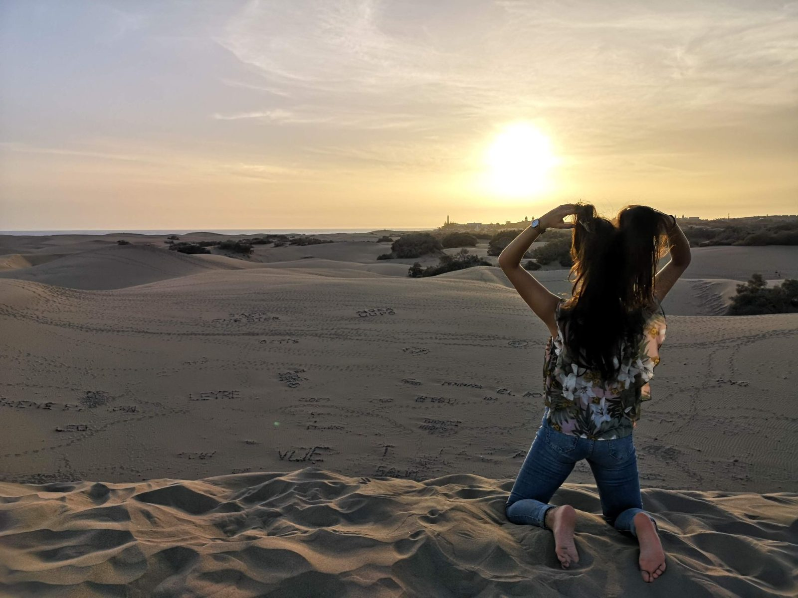
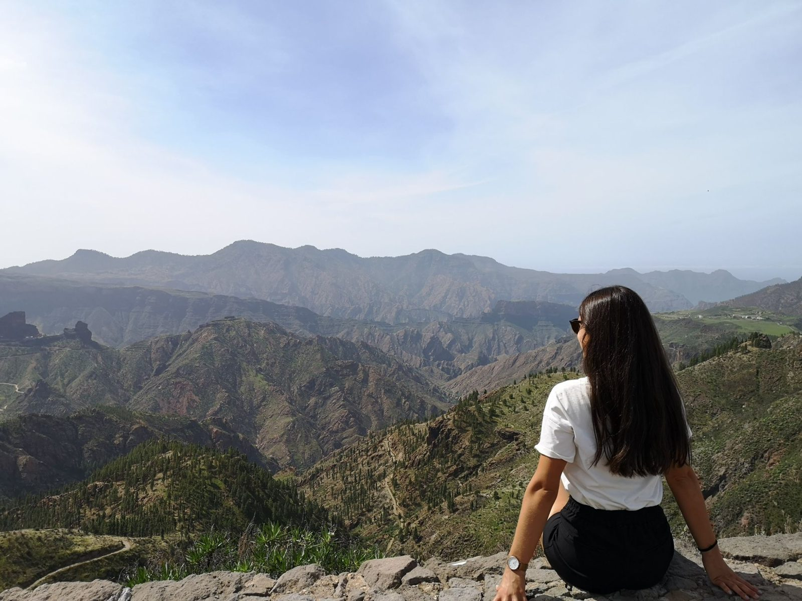
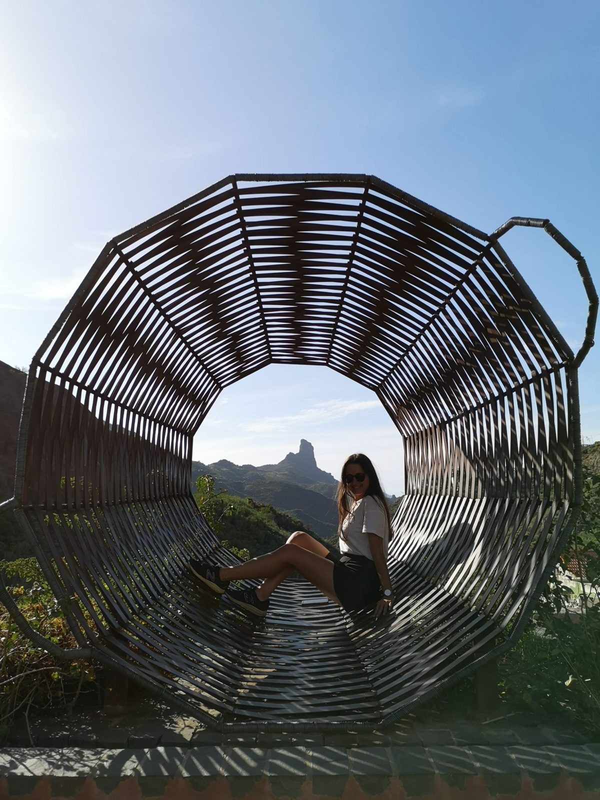
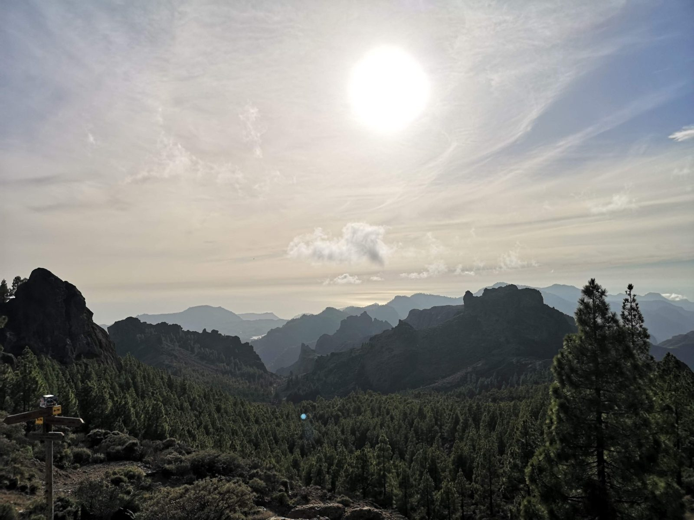
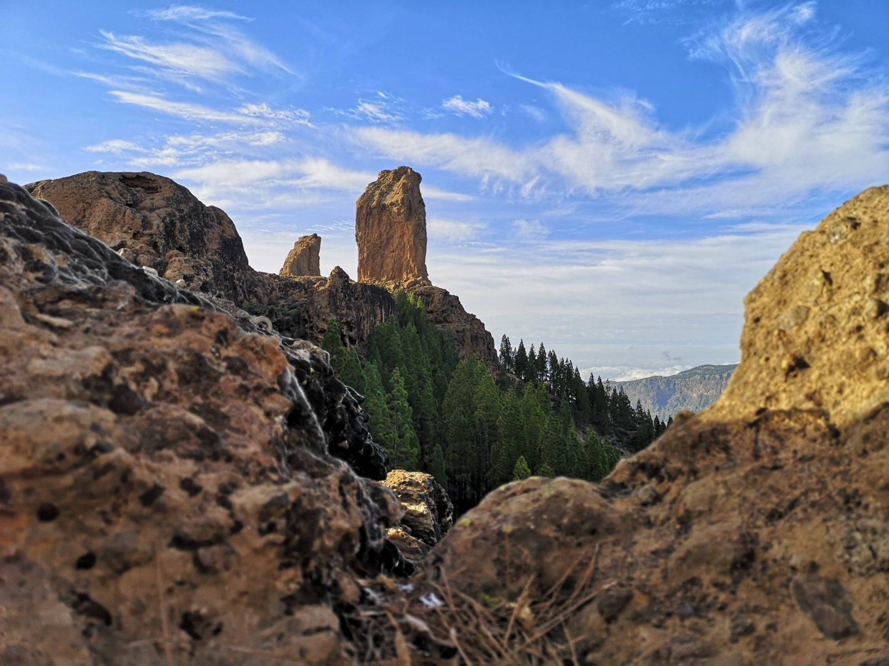
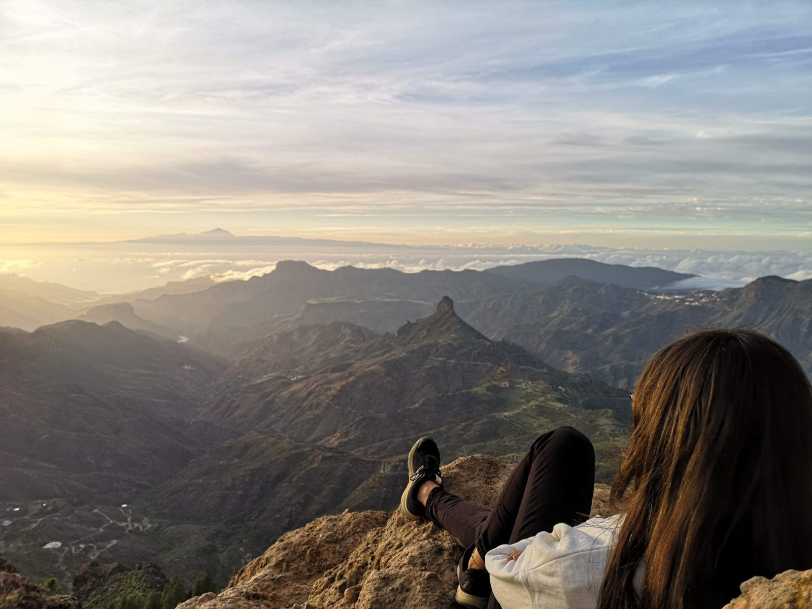
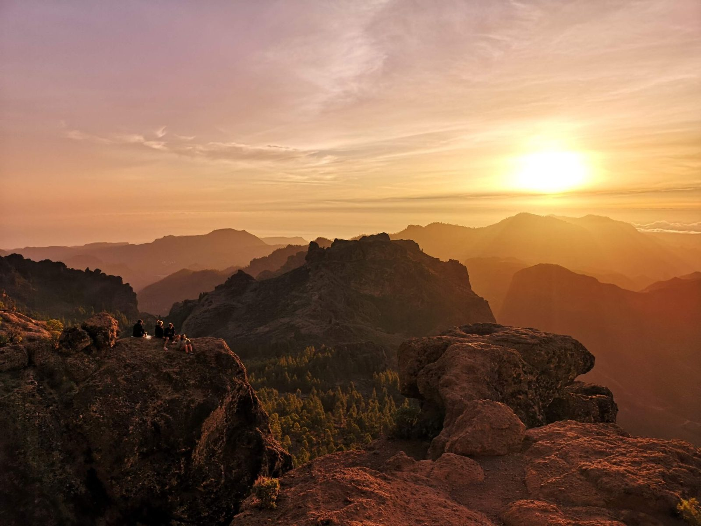
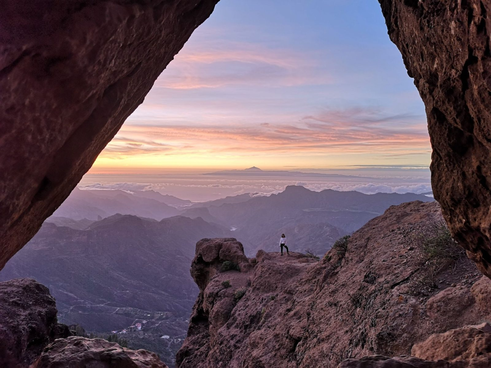
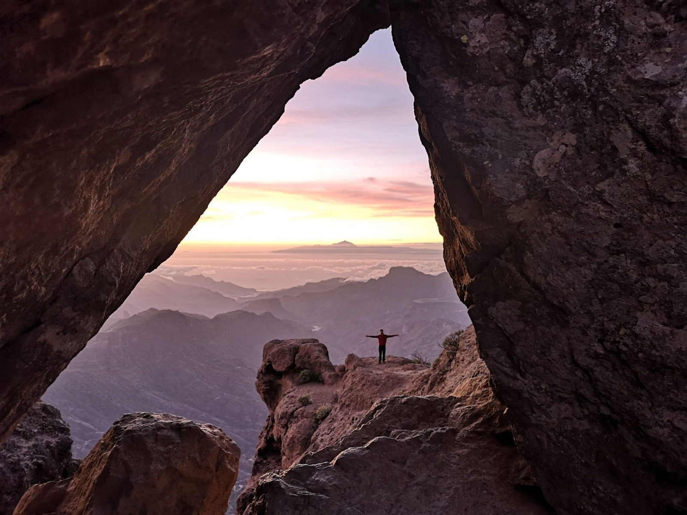

> **Antes de ir, revisad que todo sigue abierto.** Hicimos este viaje en octubre de 2022. Desde entonces pueden haber cambiado horarios, precios, accesos o normas, como ha pasado con el Roque Nublo. Algunos senderos, carreteras, miradores o restaurantes pueden estar cerrados por obras, desprendimientos o temporales. Consultad las webs oficiales del Cabildo de Gran Canaria y de cada ayuntamiento, y llamad a los restaurantes antes de ir.
{: .ojo}

## En pocas palabras

Recorrimos Gran Canaria en coche durante cinco días, durmiendo siempre en Las Palmas.
Cada día hicimos una ruta distinta: barrancos y casas cueva en el sureste, pueblos de montaña en la cumbre y pueblos con encanto en el norte.
Comimos de maravilla por muy poco dinero. Y vimos el atardecer más bonito de nuestra vida desde el Roque Nublo.

> ¡Es una isla para volver y seguir descubriéndola!
{: .cita}

## Cuándo ir

- **Todo el año**: Gran Canaria tiene buen tiempo en cualquier época.
- **Octubre**, cuando fuimos nosotros, es muy buen mes: temperaturas agradables y menos gente que en verano.
- **En la cumbre** (Roque Nublo, Tejeda, Artenara) refresca bastante, sobre todo al atardecer. Llevad algo de abrigo.

## Cómo llegar y moverse

- **Avión**: volamos desde Sevilla hasta el aeropuerto de Gran Canaria.
- **Coche de alquiler**: imprescindible para recorrer la isla. Nosotros alquilamos con **Cicar**: se recoge y se deja en el mismo aeropuerto. Siempre que vamos a las Islas Canarias alquilamos coche con Cicar, la empresa líder en las islas.
- **Dónde dormir para moverse**: elegimos Las Palmas de Gran Canaria. Está a unos 20 minutos del aeropuerto en coche, y desde allí se llega bien a toda la isla.
- **Carreteras**: las de la cumbre tienen muchas curvas. Merecen la pena, pero calculad más tiempo del que marca el mapa. Id con calma y disfrutad del paisaje.

> Organizad cada día por zonas (sureste, cumbre, norte). Así se aprovecha mucho más el tiempo y se conduce menos.
{: .truco}

## Itinerario día a día



### Día 1 (jueves): Llegada y Vegueta de noche

🌙 **Noche:** al llegar nos dio tiempo de ver la **Catedral de Santa Ana**, en la plaza de Santa Ana. Merece la pena verla de día y de noche. También hay *free tours* por el barrio.

<!-- FOTO: Catedral de Santa Ana iluminada de noche -->

### Día 2 (viernes): Sureste, barrancos y dunas

🌅 **Mañana:** paseo breve por el **centro histórico de Las Palmas**, para aprovechar el resto del día fuera. En coche hasta la **Caldera de Bandama**: un sendero maravilloso, lleno de paz, de verde y de lagartos. Bajamos hasta el mirador y volvimos.

Seguimos hasta **Telde**: paseo por el pueblo, la plaza y la **Basílica de San Juan Bautista**. Después, **El Bufadero**. ¡Increíble!

☀️ **Tarde:** el **Barranco de Guayadeque**, un auténtico espectáculo de la naturaleza. Se respira paz. Hay **casas cueva** donde todavía vive gente, y algún dueño os deja entrar a verla. Comimos en el **Bar Restaurante Guayadeque** (más abajo os contamos).

Después de comer subimos por unas escaleras para ir viendo las casas cueva. Luego dejamos el coche al final de la carretera, en una cuesta sin salida junto al restaurante Tagoror. Seguimos paseando y compramos unos imanes en la tienda de recuerdos.

De ahí, a **Agüimes**, justo al lado: un pueblo precioso y curioso por la cantidad de estatuas que hay por las calles. Sentaos un rato en la plaza de la **parroquia de San Sebastián**.

Y después, el **Barranco de las Vacas**:
- Coged la carretera en dirección a **Temisas** y aparcad en los huecos que hay en el arcén.
- Desde ahí se baja enseguida: en la segunda curva se ve un hueco en el quitamiedos por el que se accede.
- Al llegar a la altura de un puente, girad a la derecha y andad unos minutos.
- Llegaréis a un sitio espectacular. Hay que ir para descubrirlo.

> **Ubicación exacta:** 27.912783, -15.474675 ([abrir en Google Maps](https://www.google.com/maps/search/?api=1&query=27.912783,-15.474675)). En el navegador del móvil es mejor buscar «Tobas de Colores del Barranco de las Vacas»: si buscáis solo «Barranco de las Vacas», os puede llevar a otro sitio.
{: .dato}

> Aparcad sin estorbar: los bomberos de Gran Canaria se han quejado de los coches en los arcenes, porque retrasan las emergencias.
{: .ojo}

🌙 **Noche:** atardecer en las **Dunas de Maspalomas**. Aparcamos cerca del hotel Riu Palace Maspalomas, lo atravesamos y llegamos enseguida a las dunas. Vuelta a Las Palmas tras un día maravilloso y muy completo, ¡de los que no se olvidan!

<!-- FOTO: Barranco de Guayadeque y casas cueva -->
<!-- FOTO: Barranco de las Vacas -->

### Día 3 (sábado): La cumbre, Artenara, Tejeda y el Roque Nublo

🌅 **Mañana:** después de desayunar, vuelta por el centro: compramos lotería, fuimos al **mercado de Vegueta** y paseamos junto a la catedral. En coche, parada en **Santa Brígida**.

De camino a Artenara, nos paramos en un mirador donde vimos muchos coches y motos: el **Mirador Astronómico de Pinos de Gáldar**.

**Artenara** es difícil de describir: miradores de ensueño hacia el Roque Nublo. Nos quedamos impactados. Visita obligatoria.
- **Mirador del Corazón de Jesús**: vistas difíciles de superar al Roque Nublo, el Roque Bentayga y el Roque del Camello.
- **Mirador de Unamuno**: también espectacular.
- **Museo Etnográfico Casas Cuevas**: gratuito, con donativo voluntario. Muy recomendable: cuenta cómo se vivía, y se sigue viviendo, en las casas cueva.
- Paseo por la **iglesia de San Matías** y subida a la **ermita de la Cuevita**.

☀️ **Tarde:** comida en **Tejeda** nada más llegar y paseo por su centro histórico, muy bonito. Café y un dulce de almendra para compartir. En Tejeda son típicos los **dulces de almendra** y los **helados**.

🌙 **Atardecer:** el **Roque Nublo**, un lugar mágico que jamás podremos olvidar. La carretera tiene muchas curvas, pero se va disfrutando del paisaje.
- Dejamos el coche en el aparcamiento de la **Degollada de la Goleta**. Desde 2025 ya no se puede: mirad el aviso de abajo.
- El sendero, de piedras y rocas, tiene unos **1,5 km**. Lo subimos en media hora, parando a hacer fotos.
- Por el camino se van viendo el **Fraile**, el **Roque Nublo** y **la Rana**.
- Al llegar, lo mejor es meterse **por detrás de las rocas**: se llega a un sitio indescriptible, con unas vistas que nunca habíamos visto. ¡Hasta se veía el **Teide**!

Nos quedamos allí una hora y media sentados, enamorados del silencio y de la paz, viendo el atardecer. Cuanto más atardecía, más bonito se ponía todo: mezclas de colores, naranjas… A lo lejos, a la derecha, un **mar de nubes** parecía caer en cascada. Buscad una ventanita entre las rocas: sale una foto clave.

> **Desde febrero de 2025 hace falta reserva previa para subir al Roque Nublo** en las horas de más visitas (de 9:00 a 17:00). Ya no se puede aparcar junto al inicio del sendero: se llega en un autobús lanzadera. Antes de ir, comprobad en la web del Cabildo de Gran Canaria los horarios, cómo se sube para ver el atardecer y cómo se reserva *(por confirmar)*{: .por-confirmar}.
{: .ojo}

La foto clave, desde la ventanita entre las rocas:

### Día 4 (domingo): Pueblos del norte

🌅 **Mañana:** ruta por tres pueblos bonitos y cercanos entre sí. Empezamos por **Arucas**: en una plaza preciosa está la **parroquia de San Juan Bautista**, que más bien parece una catedral. ¡Flipante!

☀️ **Tarde:** camino de Firgas, paramos a comer en el **Asadero La Caldera**. Para nosotros, el mejor sitio de la isla (más abajo os contamos). Después, **Firgas**: preciosos el **Paseo de Canarias** y el **Paseo de Gran Canaria**.

Seguimos hacia **Teror**: paseo por sus calles, la **Basílica de Nuestra Señora del Pino** y una plaza muy bonita, con mucho ambiente festivo. Luego, **Gáldar**, lugar de peregrinación jacobea, con una parroquia muy bonita.

🌙 **Noche:** para terminar el día, como no podía ser de otra forma, atardecer en el **Faro de Punta Sardina**.

<!-- FOTO: Parroquia de San Juan Bautista de Arucas -->
<!-- FOTO: Atardecer en el Faro de Punta Sardina -->

### Día 5 (lunes): Jardín Botánico y vuelta

🌅 **Mañana:** visita al **Jardín Botánico Viera y Clavijo**, antes de ir al aeropuerto. La entrada es gratuita. Los horarios que hemos encontrado no coinciden *(por confirmar)*{: .por-confirmar}.

☀️ **Mediodía:** devolución del coche (en nuestro caso, a las 12:00 como muy tarde) y vuelo de vuelta.

## Dónde comer

| Sitio | Qué pedir | Precio por persona |
|---|---|---|
| **Bar Restaurante Guayadeque** (Barranco de Guayadeque) | Pan con alioli, **papas arrugadas con mojo rojo**, carne de cerdo frita, queso frito y ropa vieja | Barato, y sigue siéndolo |
| **Asadero La Caldera** (Firgas, Calle Caldera 14) | Queso asado, papas arrugadas con mojo, croquetas de dátiles, garbanzada y bistec de cerdo | Unos 12 € (en 2022) |
| **Tejeda** | Dulces de almendra y helados | — |

> En el Asadero La Caldera pedimos pan, media ración de queso asado, media de papas arrugadas con un mojo buenísimo, media de croquetas de dátiles, una tapa de garbanzada y bistec de cerdo: dos filetes enormes y jugosos por 5,20 €. Con dos cafés y dos botellas grandes de agua, salimos a 12 € por cabeza… ¡y casi salimos rodando!
{: .dato}

> El Asadero La Caldera no acepta reservas y los fines de semana se llena: id pronto o contad con esperar.
{: .truco}

> En el Bar Restaurante Guayadeque no os perdáis las papas arrugadas con mojo rojo. Es cocina casera canaria, exageradamente buena y barata: no hay mejor sitio para comer por la zona.
{: .truco}

Estos dos restaurantes, el Asadero La Caldera y el Bar Restaurante Guayadeque, se han convertido en nuestros sitios favoritos de la isla. Muy recomendables.

## Dónde dormir

- **Las Palmas de Gran Canaria**: buena base para recorrer toda la isla en coche, a unos 20 minutos del aeropuerto.

Nosotros nos alojamos en **Aminta Home**, un *bed & breakfast* en una casa canaria tradicional. Está en la zona de Tafira (Calle Hernán Pérez de Grado, 30), a unos 3,5 km del centro de Las Palmas y muy cerca del Jardín Botánico. Tiene salón y comedor compartidos y un patio.

En 2022 pagamos **181 € por las 4 noches, con desayuno incluido**, para los dos (unos 45 € la noche). Una relación calidad-precio estupenda.

> Ese es el precio de octubre de 2022: hoy seguramente será distinto. Consultadlo en las webs de reservas antes de ir.
{: .dato}

## Consejos prácticos

- **Comprobad antes de salir**: después de lluvias fuertes o temporales se suelen cerrar senderos, barrancos y carreteras de montaña. Mirad los avisos del Cabildo de Gran Canaria y de la AEMET el mismo día.
- **Coche**: imprescindible. Las rutas por barrancos y cumbres no se pueden hacer bien en transporte público.
- **Roque Nublo**: reserva previa y lanzadera desde 2025 (mirad el aviso del día 3).
- **Atardeceres**: planificad cada día para terminar en un buen sitio para ver el atardecer: Maspalomas, Roque Nublo, Punta Sardina…
- **Abrigo**: en la cumbre hace frío al caer el sol, aunque en la costa haga calor.
- **Calzado**: cómodo y con buena suela para la Caldera de Bandama, el Barranco de las Vacas y el Roque Nublo.
- **Museo de las casas cueva de Artenara**: gratuito, con donativo voluntario.

## Para la próxima visita

Nos quedaron pendientes, y son obligados la próxima vez:

- [ ] Subir al **Pico de las Nieves**, a poder ser para ver el atardecer
- [ ] Ruta por el paraje natural de **Los Tilos de Moya**
- [ ] **Mogán** y **Puerto de Mogán**
- [ ] **Mirador de la Sorrueda** y sus presas
- [ ] **Mirador del Balcón**
- [ ] **Risco Faneque**
- [ ] **Agaete**
- [ ] **Tirajana**

## Galería



## Fuentes

- [Turismo de Gran Canaria](https://www.grancanaria.com/turismo/)
- [Cabildo de Gran Canaria](https://cabildo.grancanaria.com/)
- [AEMET: avisos meteorológicos](https://www.aemet.es/es/eltiempo/prediccion/avisos)
- [Reserva previa en el Roque Nublo (RTVC)](https://rtvc.es/el-acceso-a-roque-nublo-exigira-reserva-previa-a-partir-de-febrero/)
- [Horario y reservas para subir al Roque Nublo (eldiario.es)](https://www.eldiario.es/canariasahora/sociedad/horario-subir-roque-nublo-acceder-reservar-visita_1_13415122.html)
- [Aparcamiento en el Barranco de las Vacas (RTVC)](https://rtvc.es/piden-senalizacion-y-aparcamientos-en-barranco-de-las-vacas/)
- [Barranco de las Vacas: ubicación (Showcaves)](https://showcaves.com/english/es/gorges/Vacas.html)
- [Museo Etnográfico Casas Cuevas de Artenara (Hello Canary Islands)](https://www.hellocanaryislands.com/museums-and-places-of-interest/gran-canaria/museo-etnografico-de-las-casas-cuevas-de-artenara/)
- [Asadero La Caldera (Gastroranking)](https://gastroranking.es/r/asadero-la-caldera_73527/)
- [Jardín Botánico Viera y Clavijo](https://www.grancanaria.com/turismo/en/nature/swimming-in-a-sea-of-strange-plants/)
- [Cicar: alquiler de coches](https://www.cicar.com/)
- [Aminta Home (Kayak)](https://www.kayak.es/Las-Palmas-de-Gran-Canaria-Hoteles-Aminta-Home.2783167.ksp)
